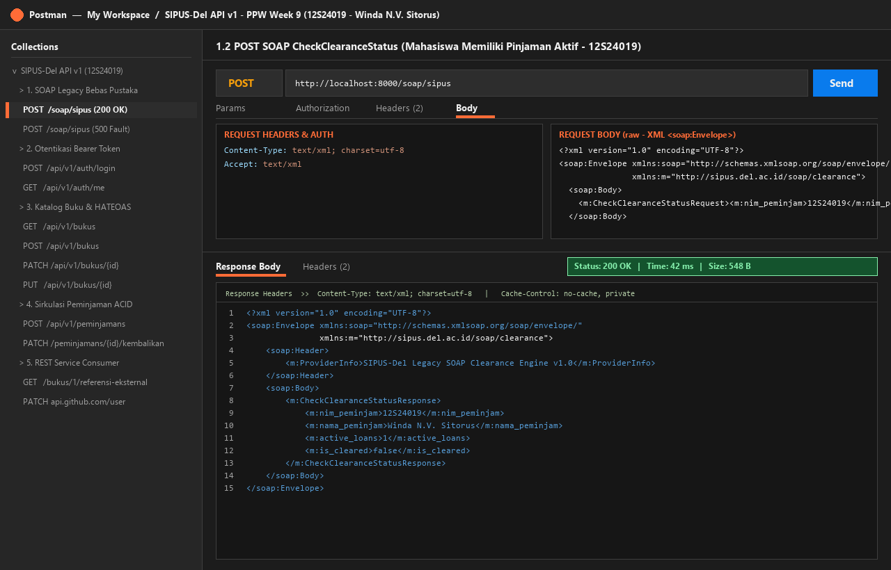
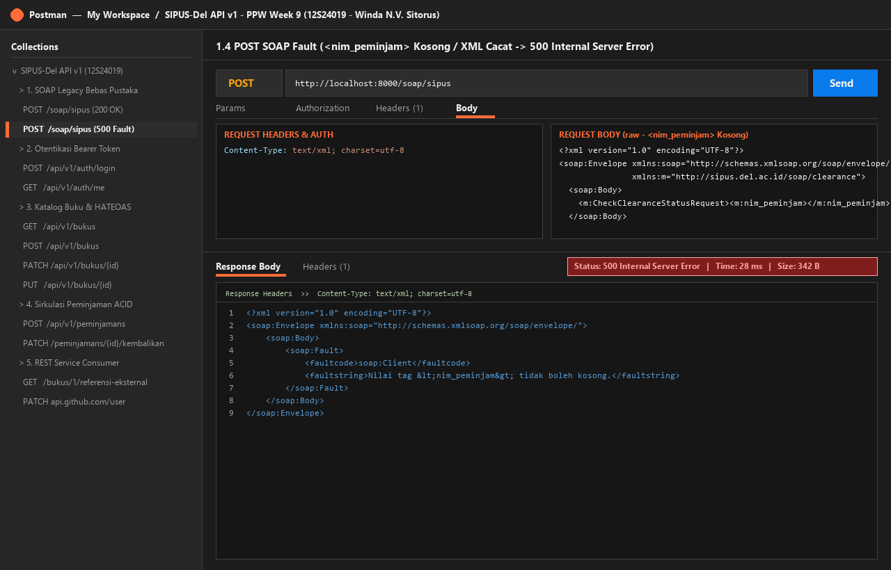
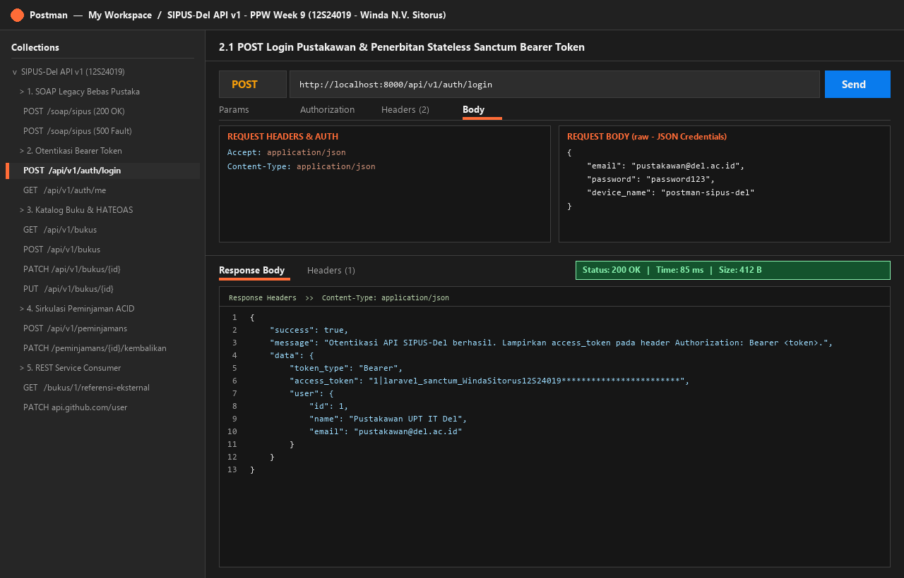
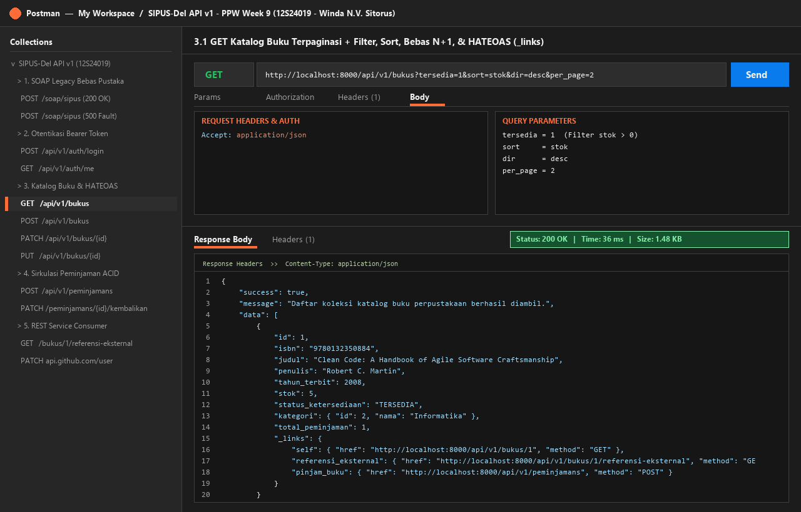
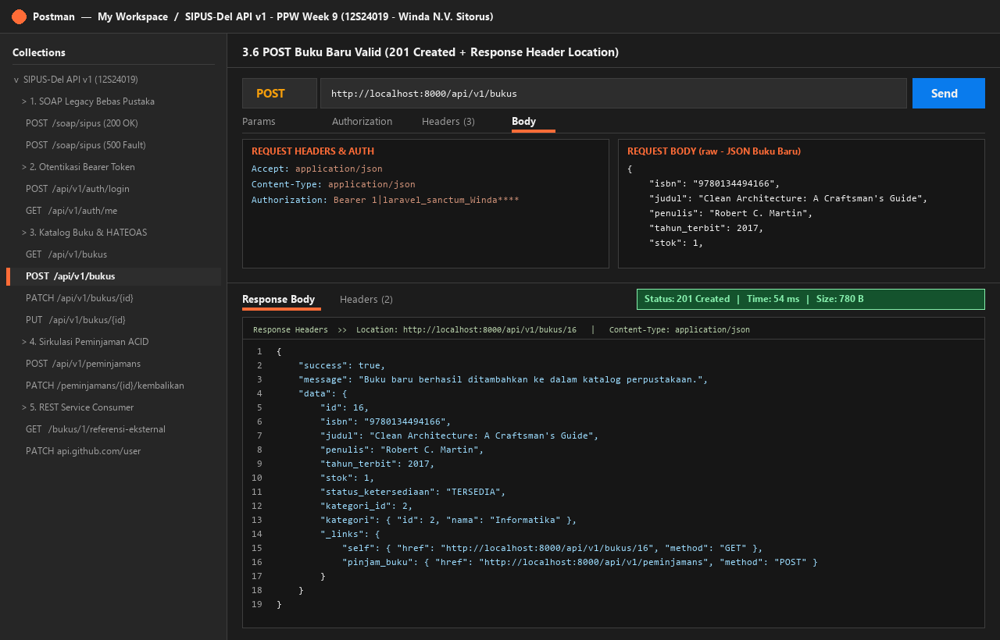
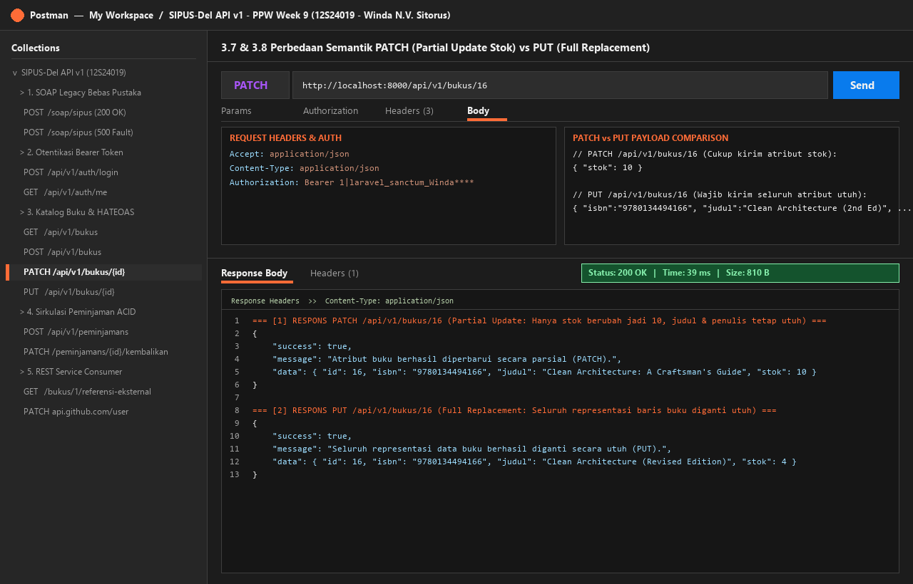
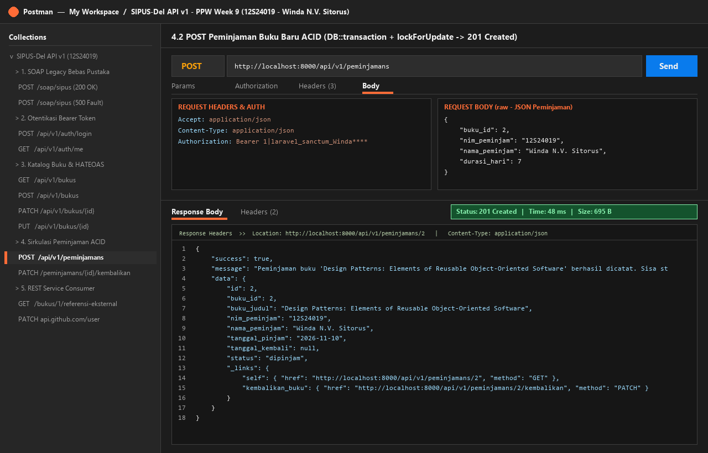
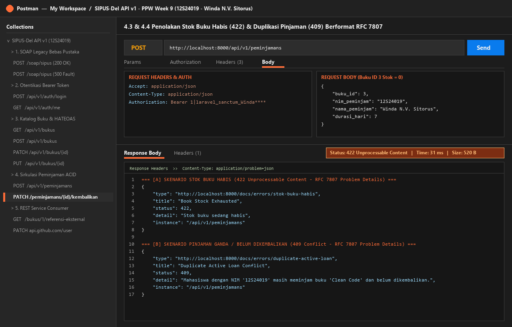
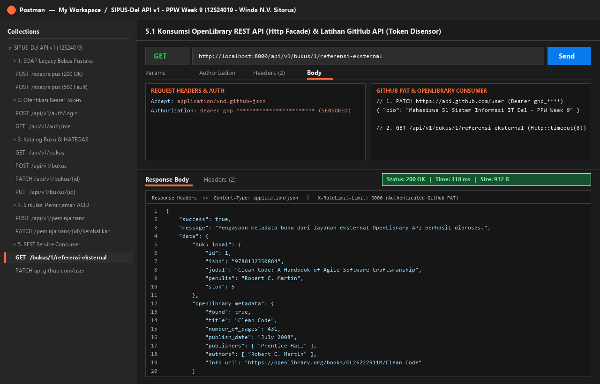

# 📚 SIPUS-Del Tahap 3: Layanan Web SOAP Legacy & RESTful Web API v1

Pengembangan Lanjutan Sistem Informasi Perpustakaan Kampus Del (**SIPUS-Del Tahap 3**): Analisis Kelayakan Layanan, Simulasi Ringkas Endpoint SOAP Legacy, serta Implementasi Mendalam RESTful Web API Provider & Consumer (API v1) Berbasis Eloquent Resource, Transaksi Sirkulasi ACID, Stateless Bearer Token, HATEOAS, & Kontrak OpenAPI 3.0 pada Laravel 11.x.

---

## 1. 👨‍💻 Identitas Mahasiswa

| Atribut | Keterangan |
| :--- | :--- |
| **Nama Lengkap** | Winda N.V. Sitorus |
| **NIM** | 12S24019 |
| **Kelas** | 12SI1 / Sistem Informasi |
| **Program Studi** | S1 Sistem Informasi — Fakultas Informatika dan Teknik Elektro (FITE), Institut Teknologi Del |
| **Mata Kuliah** | Pemrograman dan Pengujian Aplikasi Web (12S3101) — Minggu 9 |
| **Dosen Pengampu** | Chandro Pardede, S.Kom., M.Sc. |

---

## 2. 🔍 Analisis Kebutuhan & Kelayakan Web Services (Feasibility Analysis)

Pada pengembangan tahap sebelumnya (Minggu 5 & Minggu 6), **SIPUS-Del** beroperasi sebagai aplikasi web monolitik (*human-oriented*) yang merender halaman HTML + CSS (Blade) untuk diakses oleh pengguna melalui peramban web (*browser*). Memasuki Minggu 9, UPT Perpustakaan IT Del membutuhkan integrasi lintas sistem (*machine-to-machine* / M2M) dengan ekosistem kampus dan layanan eksternal.

### A. Pemetaan Peran Arsitektur: *Service Provider* vs *Service Consumer*

| No | Skenario Integrasi Bisnis | Peran SIPUS-Del | Mitra / Sistem Terkait | Protokol & Format Data | Alasan Kelayakan & Domain Ownership |
| :-: | :--- | :--- | :--- | :--- | :--- |
| **1** | **Pengecekan Bebas Pustaka Yudisium** | **Service Provider** (SOAP) | Sistem Administrasi Yudisium Kampus (Legacy) | SOAP 1.1 over HTTP (`text/xml`, WSDL, `<soap:Envelope>`) | Data sirkulasi peminjaman buku mahasiswa merupakan *domain bisnis inti* milik UPT Perpustakaan. Karena sistem Yudisium lama masih berbasis SOAP XML, SIPUS-Del menyediakan endpoint kompatibilitas `/soap/sipus`. |
| **2** | **Katalog & Sirkulasi Mandiri (Mobile App & Kiosk)** | **Service Provider** (REST API v1) | Aplikasi Mobile Mahasiswa (Flutter/Kotlin) & Kiosk Mandiri Perpustakaan | RESTful HTTP/S (`application/json` & `application/problem+json`) | Katalog buku (`bukus`) dan transaksi peminjaman (`peminjamans`) dikelola secara terpusat oleh SIPUS-Del dan diekspos melalui kontrak RESTful `/api/v1/...` yang *stateless*. |
| **3** | **Pengayaan Metadata Buku Internasional (ISBN)** | **Service Consumer** (REST Client) | **OpenLibrary REST API** (`openlibrary.org`) | REST over HTTPS (`application/json` via Laravel `Http` Facade) | Menyimpan jutaan metadata bibliografi global (jumlah halaman, penerbit internasional, sampul, tautan pratinjau) di database lokal tidak layak secara biaya dan kapasitas. SIPUS-Del cukup memanggil OpenLibrary API sesuai kebutuhan (*on-demand*). |

### B. Alasan Teknis Pemilihan REST untuk Aplikasi Mobile & Kiosk Dibandingkan SOAP

1. **Efisiensi Payload & Bandwidth**: REST menggunakan representasi JSON (`application/json`) yang 5–8 kali lebih ringkas dibandingkan amplop XML `<soap:Envelope>` pada SOAP. Hal ini sangat krusial bagi aplikasi *Mobile* mahasiswa yang beroperasi pada jaringan seluler dengan keterbatasan kuota dan latensi.
2. **Pemanfaatan Semantik Alami HTTP**: REST memanfaatkan *HTTP Verbs* (`GET`, `POST`, `PUT`, `PATCH`, `DELETE`) dan *HTTP Status Codes* (`200`, `201`, `204`, `401`, `404`, `409`, `422`) secara langsung tanpa melakukan *tunneling* seluruh operasi ke dalam satu metode `POST` seperti pada SOAP.
3. **Statelessness & Skalabilitas Horizontal**: Dengan menggunakan **Laravel Sanctum Bearer Token** (`Authorization: Bearer <token>`), server SIPUS-Del tidak menyimpan *session state* klien di memori server (*Zero Server Session*), sehingga siap diskalakan di belakang *Load Balancer* untuk melayani ribuan mahasiswa secara bersamaan.
4. **Dukungan Native & Hypermedia (HATEOAS)**: Format JSON didukung secara *native* oleh seluruh kerangka kerja modern (Flutter/Dart, React/JS, Kotlin), serta dilengkapi kontrol `_links` (Richardson Maturity Model Level 3) yang memandu klien secara dinamis berdasarkan status stok buku dan status pinjaman.

---

## 3. 🗺️ Tabel Katalog Endpoint Web Services (SOAP & REST API v1)

### A. Layanan SOAP Legacy Bebas Pustaka

| Method | URI Endpoint | Operasi / Fungsi | Proteksi Auth | Kode Status Respons |
| :---: | :--- | :--- | :---: | :--- |
| `GET` | `/soap/sipus.wsdl` | Menampilkan dokumen kontrak XML WSDL untuk layanan `SipusClearanceSoapService` (`CheckClearanceStatus`). | Publik | `200 OK` (`text/xml`) |
| `POST` | `/soap/sipus` | Menerima `<soap:Envelope>` berisi `<nim_peminjam>`, menghitung pinjaman aktif (`status = 'dipinjam'`), dan mengembalikan `<active_loans>` serta `<is_cleared>`. | Publik (Bebas CSRF) | `200 OK` (`<soap:Envelope>`) / `500 Internal Server Error` (`<soap:Fault>`) |

### B. Layanan RESTful Web API v1 (`/api/v1/...`)

| Method | URI Endpoint | Proteksi Auth | Deskripsi Bisnis & Fitur | Kode Status Respons |
| :---: | :--- | :---: | :--- | :--- |
| `POST` | `/api/v1/auth/login` | Publik | Memverifikasi kredensial pustakawan (`email` & `password`) dan menerbitkan Sanctum Bearer Token (`plainTextToken`). | `200 OK`, `401 Unauthorized`, `422 Unprocessable Content` |
| `GET` | `/api/v1/auth/me` | `Bearer Token` (`auth:sanctum`) | Mengambil profil pustakawan pemilik token yang sedang aktif. | `200 OK`, `401 Unauthorized` |
| `POST` | `/api/v1/auth/logout` | `Bearer Token` (`auth:sanctum`) | Mencabut (*revoke*) token akses yang sedang digunakan. | `200 OK`, `401 Unauthorized` |
| `GET` | `/api/v1/bukus` | Publik | Menampilkan katalog buku terpaginasi (`meta`) dengan dukungan `?search=`, `?kategori_id=`, `?tersedia=1`, `?sort=`, `?dir=`, bebas *N+1 Query*, dan HATEOAS `_links`. | `200 OK` |
| `GET` | `/api/v1/bukus/{id}` | Publik | Menampilkan detail satu buku (berdasarkan ID atau ISBN) beserta objek `kategori`, `riwayat_peminjaman`, dan `_links`. | `200 OK`, `404 Not Found` (RFC 7807) |
| `POST` | `/api/v1/bukus` | `Bearer Token` (`auth:sanctum`) | Menyimpan buku baru dengan validasi ketat (ISBN unik, `stok >= 0`, `kategori_id` valid) dan menyertakan header `Location`. | `201 Created` (+ `Location`), `401`, `422` (RFC 7807) |
| `PUT` | `/api/v1/bukus/{id}` | `Bearer Token` (`auth:sanctum`) | Mengganti seluruh representasi data buku secara utuh (*Full Replacement*). | `200 OK`, `401`, `404`, `422` |
| `PATCH` | `/api/v1/bukus/{id}` | `Bearer Token` (`auth:sanctum`) | Memperbarui sebagian atribut buku secara parsial (*Partial Update* dengan `sometimes\|required`, misal hanya `stok`). | `200 OK`, `400`, `401`, `404`, `422` |
| `DELETE` | `/api/v1/bukus/{id}` | `Bearer Token` (`auth:sanctum`) | Menghapus buku. Ditolak dengan `409 Conflict` jika masih ada peminjaman berstatus `'dipinjam'`. | `204 No Content`, `401`, `404`, `409 Conflict` |
| `GET` | `/api/v1/bukus/{id}/referensi-eksternal` | Publik | **REST Service Consumer**: Mengambil metadata buku tambahan dari **OpenLibrary REST API** (`Http::timeout(8)`) beserta fallback aman. | `200 OK`, `404 Not Found`, `502 Bad Gateway` |
| `GET` | `/api/v1/peminjamans` | `Bearer Token` (`auth:sanctum`) | Menampilkan daftar transaksi sirkulasi peminjaman terpaginasi dengan filter `?status=dipinjam\|dikembalikan` dan `?nim=`. | `200 OK`, `401 Unauthorized` |
| `GET` | `/api/v1/peminjamans/{id}` | `Bearer Token` (`auth:sanctum`) | Menampilkan detail satu transaksi peminjaman beserta HATEOAS `_links`. | `200 OK`, `401`, `404 Not Found` |
| `POST` | `/api/v1/peminjamans` | `Bearer Token` (`auth:sanctum`) | Mencatat peminjaman buku baru secara atomik (`DB::transaction()` + `lockForUpdate()`). Menolak jika stok habis (`422`) atau pinjaman ganda aktif (`409`). | `201 Created` (+ `Location`), `401`, `404`, `409 Conflict`, `422` |
| `PATCH` | `/api/v1/peminjamans/{id}/kembalikan` | `Bearer Token` (`auth:sanctum`) | Mengembalikan buku secara atomik (`DB::transaction()` + `lockForUpdate()`), mengubah status ke `'dikembalikan'`, mengisi `tanggal_kembali`, dan menambah stok (`+1`). | `200 OK`, `401`, `404`, `409 Conflict` |

---

## 4. 🚀 Panduan Instalasi & Pengujian Cepat

Ikuti langkah-langkah berikut untuk menjalankan dan menguji proyek ini di lingkungan lokal:

### 1. Instalasi Dependensi & Konfigurasi Environment
```bash
composer install
cp .env.example .env
php artisan key:generate
```

### 2. Migrasi Database & Seeding Data Awal
Pastikan berkas database SQLite tersedia, lalu jalankan migrasi beserta seeder:
```bash
php artisan migrate:fresh --seed
```

### 3. Kredensial Akun Uji Pustakawan (Seeder Lokal)
Gunakan akun berikut pada endpoint `POST /api/v1/auth/login` untuk memperoleh **Sanctum Bearer Token**:
* **Email**: `pustakawan@del.ac.id`
* **Password**: `password123`

### 4. Menjalankan Server Lokal
```bash
php artisan serve
```
Server akan berjalan pada `http://localhost:8000`.
* Antarmuka Web Monolitik (Blade Minggu 5/6): `http://localhost:8000/buku`
* Kontrak WSDL SOAP Legacy: `http://localhost:8000/soap/sipus.wsdl`
* Endpoint REST API v1: `http://localhost:8000/api/v1/bukus`

### 5. Mengimpor Kontrak OpenAPI 3.0 & Koleksi Postman
* **Kontrak OpenAPI 3.0**: Tersedia di [`docs/openapi-sipus-v1.yaml`](docs/openapi-sipus-v1.yaml) (dapat dibuka langsung melalui [Swagger Editor](https://editor.swagger.io)).
* **Koleksi Postman**: Buka aplikasi **Postman Desktop**, klik **Import**, lalu pilih berkas [`docs/SIPUS-Del-API-v1.postman_collection.json`](docs/SIPUS-Del-API-v1.postman_collection.json).
  * Jalankan request **2.1 POST Login Pustakawan** terlebih dahulu — skrip *Tests* pada koleksi Postman akan secara otomatis menyimpan `access_token` ke dalam variabel koleksi `{{token}}`!

---

## 5. 📸 Galeri Bukti Pengujian (Screenshots)

> **Catatan**: Letakkan tangkapan layar (*screenshot*) hasil pengujian Postman Anda pada folder `docs/screenshots/` atau lampirkan langsung pada bagian di bawah ini (pastikan token GitHub PAT disensor sebagian sesuai aturan keamanan modul).

### (a) Uji Layanan SOAP XML (`CheckClearanceStatus`) & `<soap:Fault>`
* **Kontrak WSDL (`GET /soap/sipus.wsdl`) & Respons Sukses `<soap:Envelope>` (`POST /soap/sipus`)**:
  
* **Respons Galat `<soap:Fault>` saat `<nim_peminjam>` Kosong (`500 Internal Server Error`)**:
  

### (b) Login Stateless Bearer Token (`POST /api/v1/auth/login`)
* **Penerbitan Sanctum `access_token` (`200 OK`)**:
  

### (c) GET Katalog Buku Terpaginasi + Kontrol Hypermedia HATEOAS (`_links`)
* **Koleksi Buku Terpaginasi dengan Blok `meta` dan `_links.pinjam_buku` Dinamis (`GET /api/v1/bukus`)**:
  

### (d) POST Buku Baru (`201 Created` + Header `Location`)
* **Pembuatan Buku Baru Beserta Bukti Header `Location: http://localhost:8000/api/v1/bukus/{id}`**:
  

### (e) Bukti Perbedaan Semantik `PUT` (Full Replacement) vs `PATCH` (Partial Update)
* **`PATCH /api/v1/bukus/{id}` (Hanya Mengubah `stok`) vs `PUT /api/v1/bukus/{id}` (Mengganti Seluruh Atribut)**:
  

### (f) Transaksi Peminjaman Buku ACID Sukses (`201`) & Penolakan Stok Habis / Konflik (`422` / `409` RFC 7807)
* **Peminjaman Sukses (`201 Created`) & Pengembalian Buku (`PATCH /kembalikan` `200 OK`)**:
  
* **Penolakan Stok Buku Habis (`422 Unprocessable Content`) & Duplikasi Pinjaman Aktif (`409 Conflict`) Berformat `application/problem+json`**:
  

### (g) Bukti Eksplorasi GitHub REST API (Token Disensor) & OpenLibrary REST Consumer
* **Latihan `PATCH https://api.github.com/user` (Bearer PAT Disensor) & `GET /api/v1/bukus/1/referensi-eksternal`**:
  
